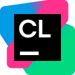
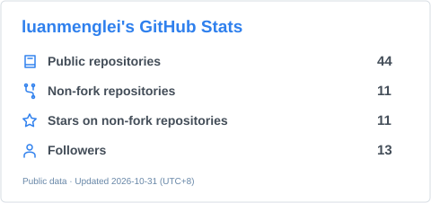

  <picture>
    <source media="(prefers-color-scheme: dark)" srcset="./assets/hello-dark.svg" />
    
  </picture>

**About me**

- 🎓 南方科技大学在读。
- 💻 算法竞赛热爱者。
- 🧱 折腾 Minecraft 小游戏。

**Languages**

   &nbsp;
   &nbsp;
  <picture><source media="(prefers-color-scheme: dark)" srcset="./assets/rust-dark.svg" /></picture> &nbsp;
   &nbsp;
   &nbsp;
  

**Editors & IDEs I've used**

   &nbsp;
   &nbsp;
   &nbsp;
   &nbsp;
   &nbsp;
   &nbsp;
  

**Operating systems**

  
  
  

 

<picture>
  <source media="(prefers-color-scheme: dark)" srcset="./assets/stats-dark.svg" />
  
</picture>
